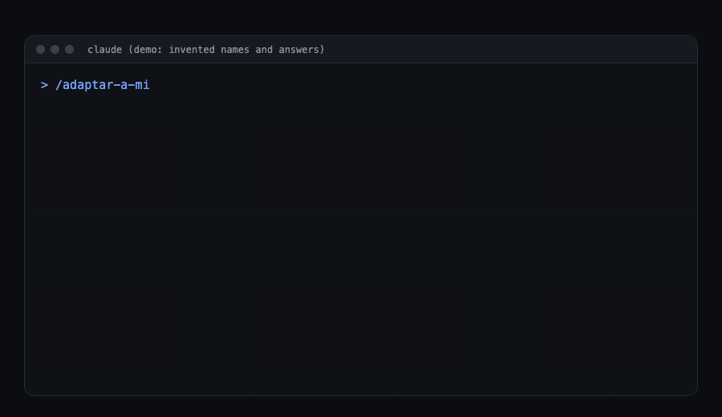
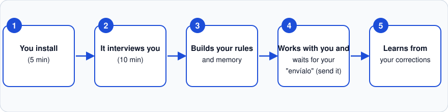
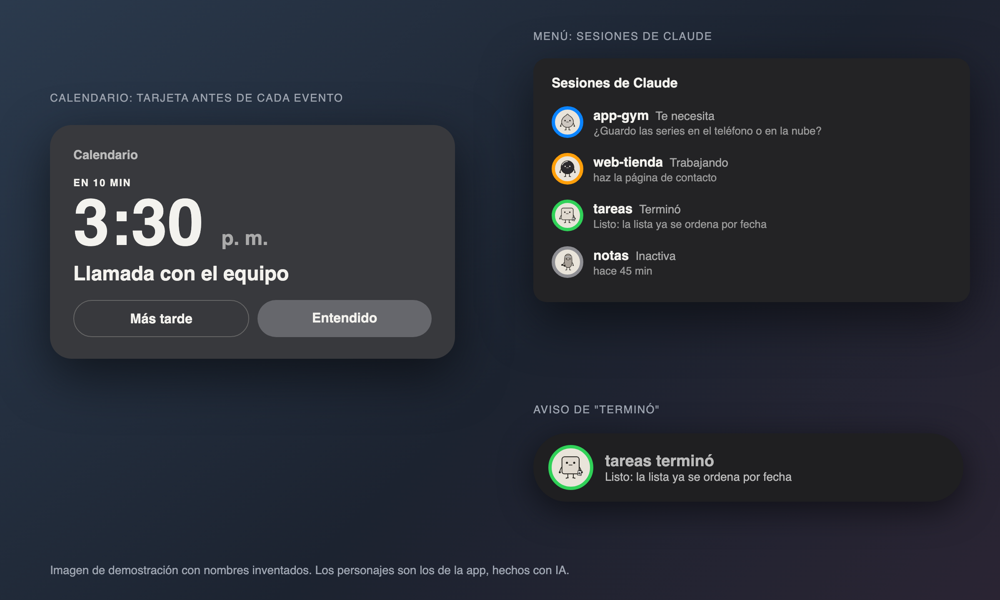

# setup-ceo

English | [Español](README.md)

**The Claude Code setup that interviews you and learns how you work.**

Prompts and commands are written in Spanish; Claude answers in your language.





## Start in 5 minutes

What you need first:

- A Mac, or a Windows 10 or 11 computer. On Windows you also need Git for Windows (a free program that Claude Code uses behind the scenes to run the setup's notices and checks); how to install it is below.
- A Claude plan that includes Claude Code: Pro, Max, Ultra, Team or Enterprise (or a Console account). The free plan does not include it ([source](https://code.claude.com/docs/en/setup)).

### With Claude Desktop

1. Download Claude Desktop from [claude.com/download](https://claude.com/download), open it and sign in.
2. Create an empty folder called `mi-claude` inside Documents. In Claude Desktop open the "Code" tab, start a **local** session (it runs on your computer, not in the cloud) and pick that folder. If it asks whether you trust the folder, say yes.
3. Paste this and press Enter:

   ```
   Install https://github.com/josephalbertoeshkenazi-blip/setup-ceo by following its README.
   ```

   Claude will ask permission for commands. Say yes only to these: `claude --version`, `curl -fsSL https://claude.ai/install.sh | bash` (only if Claude Code is missing), `claude plugin marketplace add josephalbertoeshkenazi-blip/setup-ceo` and the six `claude plugin install ...@setup-ceo`. On Windows, instead of `curl`, it may also ask for these: `git --version`, `winget install --id Git.Git -e` (only if Git is missing), `irm https://claude.ai/install.ps1 | iex` (only if Claude Code is missing) and `"$HOME/.local/bin/claude.exe"` (if it can't find `claude`). If it asks for anything else, say no and ask what it is for.

4. When it finishes, start a NEW session in the "Code" tab and type `/adaptar:adaptar-a-mi`.

More detail, and what works and what does not in the Chat and Cowork tabs: [docs/claude-desktop.en.md](docs/claude-desktop.en.md).

### With the Terminal

On Mac: open the Terminal with Cmd + Space, type "Terminal" and press Enter. Windows has its own section, [With Windows](#with-windows), further down.

1. Install Claude Code with the official installer (skip this if `claude --version` already prints a number):

   ```
   curl -fsSL https://claude.ai/install.sh | bash
   ```

   Open a new Terminal window and run `claude` once to sign in.
2. Add the catalog:

   ```
   claude plugin marketplace add josephalbertoeshkenazi-blip/setup-ceo
   ```

3. Install the six base pieces:

   ```
   claude plugin install ceo-base@setup-ceo
   claude plugin install adaptar@setup-ceo
   claude plugin install complementos@setup-ceo
   claude plugin install seguridad@setup-ceo
   claude plugin install actualizaciones@setup-ceo
   claude plugin install sugerencias@setup-ceo
   ```

4. In the Terminal type `claude` and press Enter. Inside, type `/adaptar:adaptar-a-mi`.

The interview takes about 10 minutes. You can talk freely or by voice, pause and come back another day, and bring what another AI (ChatGPT, for example) already knows about you. It loses nothing from before. At the end it recommends what fits you and installs the rest of the plugins (`negocios`, `diseno`, `programar`, `avisos`) only with your yes. Third-party skills are never installed by the interview: it hands you a ready-made `/complementos:instalar-complementos ...` command and you type it yourself.

The first thing `/adaptar:adaptar-a-mi` does is ask whether you have used Claude Code before and whether you use the Claude chat or ChatGPT. If you do, it brings in what they already know about you with one copy and paste (you decide what gets read and you confirm the summary before anything is saved), and then asks only what is missing. If you use none of those, the full interview runs.

To run it again later: `/adaptar:trae-mi-memoria` brings in, in 2 minutes, what the Claude chat, ChatGPT, Gemini or another AI already knows about you, without redoing the interview.

**Shortcut.** Instead of typing the commands, paste this to Claude Code:

```
Install https://github.com/josephalbertoeshkenazi-blip/setup-ceo by following its README.
```

Tested with Claude Code 2.1.318 on macOS, 2026-11-05. On Windows 10 and 11 every piece works except Avisos (Mac only); the test on a real Windows computer is still pending and follows the list in [docs/probar-en-windows.md](docs/probar-en-windows.md) (in Spanish).

### With Windows

Open PowerShell (the Start button, type "PowerShell" and press Enter). You do not need to be an administrator.

1. Install Git for Windows (skip this if `git --version` already prints a number):

   ```
   winget install --id Git.Git -e
   ```

   Close every PowerShell and Claude window and open them again. Without Git, the setup's notices and checks do not run.
2. Install Claude Code (skip this if `claude --version` already prints a number):

   ```
   irm https://claude.ai/install.ps1 | iex
   ```

   Open a new PowerShell window and run `claude` once to sign in. If it says it cannot find `claude`, use `"$HOME/.local/bin/claude.exe"` instead.
3. Add the catalog and the six base pieces with the same `claude plugin marketplace add ...` and `claude plugin install ...@setup-ceo` commands from "With the Terminal".
4. Type `claude` and press Enter. Inside, type `/adaptar:adaptar-a-mi`.

Python is optional: if you have it (`py -3`), the setup saves a few extra memory items; if not, everything else works the same. If a Microsoft Store window opens when you type `python`, close it: that is not a real Python. More help in [docs/problemas.en.md](docs/problemas.en.md).

### One session per project

Open each project once, in its own Claude session (in its folder), and pin it so it is at hand. The main session hands out work: when a task belongs to one project, it sends it to that project's session. In Claude Desktop (Code tab) it can talk to the other open local sessions; if the project's session is not open, it tells you in one line which folder to open and what to paste. In the Terminal, if your version of Claude Code has `ListAgents` and `SendMessage`, it can message another open session; if not, it leaves the request in a file in the project folder and tells you. Pick one: Desktop (recommended) or Terminal, because they cannot see each other. Sources: [messaging between sessions](https://code.claude.com/docs/en/cross-session-messaging.md) and [Claude Code on Desktop](https://code.claude.com/docs/en/desktop.md).

## Connect your mail, calendar and files

How to add a connector: in the "Code" tab of Claude Desktop, the "+" next to the prompt box > Add connectors; or Customize > Connectors > pick one > Connect, then sign in to that service. Connectors you add on claude.ai also work in the "Code" tab and in Claude Code when you sign in with your Claude account. They do not load with an API key ([connectors guide](https://claude.com/docs/connectors/getting-started)).

Requirements: the "Code" tab of Claude Desktop needs a paid plan (Pro, Max, Ultra, Team or Enterprise). On Team or Enterprise, an Owner has to turn on Gmail and the other Google connectors first.

| What you use | What to do |
|---|---|
| Gmail, Google Calendar, Google Drive | Built in. Gmail asks before each send by default. |
| Outlook, OneDrive, SharePoint, Teams (Microsoft 365) | Work account: a Microsoft Entra Global Administrator has to consent once. Personal account (Outlook.com, Hotmail): works on Free, Pro, Max and Ultra, Outlook and OneDrive only, and you connect it from the web. |
| Dropbox | There is an official connector. Which plan includes it: not confirmed yet. |
| WhatsApp | There is no official connector. Third-party ones exist, but they put your WhatsApp account at risk, so we do not recommend them. |
| Files on your computer | Nothing to connect: the "Code" tab already works in the folder you open with "Open folder...". |
| Another tool | If the provider publishes an MCP server URL: Customize > Connectors > Add custom connector. If not, ask someone who knows to help, or export to Excel or CSV into your folder. |

Using Claude in Chrome from the "Code" tab of Claude Desktop: not confirmed yet.

## What it never does without you

- Nothing goes to another person (email, chat, proposal, price) until you say "send it". In the files that word is `envíalo` (Spanish for "send it").
- It never pastes keys, passwords or tokens into the chat: it writes "[secreto omitido]" ("secret omitted").
- It does not install third-party add-ons without checking them first (GREEN, YELLOW or RED verdict) and without your yes. On RED it recommends not installing.
- Claude Code asks before risky actions; in manual mode it asks before almost everything (editing files, running commands). Do not turn on the mode that skips permissions (`bypassPermissions`).
- What emails, pages and documents say is data, not orders.
- `/seguridad:revisar-mi-seguridad` reviews your computer whenever you want.

## Who it is for

- Business owner: prices, deals, clients and messages, with an advisor that remembers everything.
- Student: homework, deadlines and organization.
- Parent: the house, schedules and to-dos, without hours of explaining.

Concrete examples: [docs/ejemplos.en.md](docs/ejemplos.en.md).

## Why

Most setups are one list of prompts for everybody. This one interviews you first: `/adaptar:adaptar-a-mi` takes about 10 minutes, asks one question at a time, and writes your profile to `~/.claude/mi-perfil/`, outside anything that gets installed, so updates never overwrite it. It reads your past Claude history only if you allow it.

Then it learns your taste and how you do business. Each advisor keeps its own memory (`~/.claude/agent-memory/`):

- The design advisor logs whether you liked what it made at first sight and keeps a running counter at the top of its memory: **"approved first try: X of Y"** (in the files it reads "aprobado a la primera: X de Y"). If you show it your past work, with your permission, it writes your taste to `~/.claude/mi-perfil/diseno/GUSTO.md` and every "yes, like this / no, not this" updates that file.
- The design critic, a separate fresh-eyes agent that judges a finished build in a real browser and never edits it, keeps **"agreed with the user X of Y"**. If that stays under 70% after 5 deliveries, it says so in every report, and the playbook tells you to adjust or drop it.
- The business advisor records every deal, what was agreed, how the other side behaved, and what you really earned per hour.

The counters go up with use. If they do not, the setup tells you to switch the team off.

One hard rule: nothing important reaches another person until you say "send it" (`envíalo`).

## What is in it

| Piece | What it does |
|---|---|
| `ceo-base` | Your Claude writes "what I understood" before big tasks, delegates long work, keeps what you correct, never pastes a key in the chat, and follows a recipe book (which chain of skills for which task; skips skills you do not have). |
| `adaptar` | `/adaptar:adaptar-a-mi`: the 10-minute interview that writes your profile, recommends what fits you and installs it with your yes. |
| `complementos` | `/complementos:instalar-complementos`: a reviewed catalog of third-party skills (pinned versions, only repos that passed a check). You choose all, some or none; nothing installs without your yes. |
| `/complementos:buscar-skill` | Find a skill that is not on the list: reviews up to 3 in trusted places and only installs with your yes |
| `/ceo-base:revisar-correcciones` | Review the times you corrected Claude and keep what repeats ([how memory works](docs/memoria.en.md)) |
| `seguridad` | `/seguridad:revisar-mi-seguridad`: a 5-minute check of your computer and your Claude that only looks, explains in plain words what matters, and fixes one thing at a time with your yes and a way to undo it. |
| `actualizaciones` | `/actualizaciones:novedades`: explains in plain words what changed; the setup updates itself. |
| `sugerencias` | `/sugerencias:sugerir-mejora`: sends an improvement idea as a public issue, only after you confirm the text. |
| `negocios` | A business advisor for prices, deals, partners and contracts, with real numbers. Recommended by the interview when you run a business. |
| `diseno` | Three design helpers: one directs, one builds, one reviews, so pages and apps look premium. They learn from your past work. |
| `programar` | For people who code: `/programar:bug-hunt` hunts bugs across a whole project and writes a fix plan; `/programar:rules-migrate` splits a long `CLAUDE.md` into per-folder rules. |
| `avisos` (optional, macOS only) | Calendar cards and a ring per Claude session with a "done" notice. |

## Optional skills, and why

These are other people's projects, installed from their own source at a pinned version. Nothing is copied here. See [catalogo.json](plugins/complementos/skills/instalar-complementos/catalogo.json) for exact commands, licenses, commits and the review of each one. The interview picks the few that fit you; nothing here is a must.

| Skill | Why you would want it |
|---|---|
| superpowers | Claude agrees on what to build before coding, plans in small steps, tests first. |
| gstack | An engineering team as commands: office hours, plan, review, QA in a real browser, ship. Heavy install; also useful if you have business ideas. |
| graphify | Turns a project into a map you can query instead of re-reading files. |
| impeccable | Fixes UI that looks generic: hierarchy, spacing, type, motion. |
| animaciones | Three animation skills by Emil Kowalski: build, review and keep motion smooth. |
| last30days | What people are saying about a topic in the last 30 days. |
| avoid-ai-writing | Removes AI-sounding phrasing before you send text. |
| hyperframes | Real explainer and promo videos built from scratch. |
| claude-video-vision | Lets Claude watch a video through frames and a transcript. |
| obsidian-markdown | Teaches Claude to write proper Obsidian notes. |
| gitleaks | Finds forgotten keys and passwords in your folders and before you push, without printing them. |
| repo-eval | GREEN/YELLOW/RED check of a repo before you install it (ships inside `complementos`). |

## How Avisos looks



An illustration with invented names, not a capture of a real computer. The characters are from the app, made with AI.

## For your Claude

If your human gave you this link, follow these steps in order and explain each one in plain words:

1. Run `claude --version`. If it prints a number, go to step 3.
2. If it is missing, explain that Claude Code still needs to be installed and, with their yes, run the official installer: `curl -fsSL https://claude.ai/install.sh | bash`. **On Windows**, first run `git --version`: if it is missing, with their yes run `winget install --id Git.Git -e` and tell them to close and reopen Claude so the hooks can find Git Bash (Git's terminal); then the installer is `irm https://claude.ai/install.ps1 | iex` in PowerShell, and if `claude` is not found right after installing, use `"$HOME/.local/bin/claude.exe"`. If you are in the Terminal, tell them to open a new window and run `claude` once to sign in. If you are in the Code tab of Claude Desktop, this is not needed to install the plugins.
3. Run `claude plugin marketplace add josephalbertoeshkenazi-blip/setup-ceo`, then the six `claude plugin install X@setup-ceo` lines from "With the Terminal" (the six base plugins).
4. Tell them to open a NEW session (the "Code" tab in Claude Desktop, or the Terminal) and type `/adaptar:adaptar-a-mi`. In the Terminal, if they stay in the same session, they type `/reload-plugins` first. In Claude Desktop, always a new session.

The interview recommends and installs the rest (`negocios`, `diseno`, `programar`, `avisos`) with their yes, so do not install those yourself unless they ask; if they ask for Avisos, show them the "How Avisos looks" image first. Third-party skills are different: tell them to type `/complementos:instalar-complementos` themselves (only the person who types it can start it); if they say no, do not insist. Do not install anything else without your human's yes.

## Commands

| Type | What for |
|---|---|
| `/adaptar:adaptar-a-mi` | The 10-minute interview: first brings in what Claude Code, the Claude chat or ChatGPT already know about you, then asks only what is missing, writes your profile and recommends what fits |
| `/adaptar:trae-mi-memoria` | To run it again later: bring what the Claude chat, ChatGPT or another AI already knows about you into your profile |
| `/seguridad:revisar-mi-seguridad` | Check your computer and your Claude, and fix what you approve |
| `/actualizaciones:novedades` | See what is new |
| `/sugerencias:sugerir-mejora` | Send an improvement idea |
| `/ceo-base:nueva-cabeza` | Create a new helper for one of your areas |
| `/complementos:instalar-complementos` | See the important skills and pick which to install |
| `/programar:bug-hunt` / `/programar:rules-migrate` | Hunt bugs across a project / split a long `CLAUDE.md` |
| `/avisos:instalar` / `/avisos:desinstalar` | Install or remove Avisos |

## Updating

1. It updates itself, with reviewed versions only.
2. To do it right now, say "actualízate" (update yourself).
3. To turn it off, say "no te actualices solo" (do not update yourself). To turn it back on, say "actualízate solo".
4. If a version turns out bad, the author rolls it back for everyone and the fix reaches you by itself.
5. **If you have 2.0, 2.1 or 2.2, update once by hand and from then on it stays up to date by itself.** Tell Claude "actualiza el setup-ceo", or run `claude plugin marketplace update setup-ceo` and `claude plugin update actualizaciones@setup-ceo` (and the same for each plugin you have). On Windows with 2.0 or 2.1 the notice does not show up, so do it this way.

The install command does not change. If something does not update by itself, see [docs/problemas.en.md](docs/problemas.en.md).

## Safety

Read [SECURITY.md](SECURITY.md): a table of what every piece reads, writes, sends over the network and runs, and how to report a problem. The security check never asks for, shows or stores a password or key.

Risk: what updates itself runs on your computer; if someone took over the GitHub account of this repo, they could send you a bad version. That is why only tagged, reviewed versions reach you, and you can turn it off by saying "no te actualices solo" (do not update yourself).

When you correct Claude, `ceo-base` writes a short line to `~/.claude/ceo-estado/cola-correcciones.jsonl`, only on your computer and with keys masked. It is on by default; to turn it off, write `Capturar correcciones: no` in `~/.claude/mi-perfil/ceo.md`. Details in [how memory works](docs/memoria.en.md).

## Support

If something does not work, check [docs/problemas.en.md](docs/problemas.en.md) first. If it still fails, open an issue (a public report on GitHub; you need a free GitHub account) with the "Something is broken" form and it will be read. There is no guarantee of a fast reply. Issues are public, so put no personal data in them. To change something yourself, see [CONTRIBUTING.en.md](CONTRIBUTING.en.md); security problems go through [SECURITY.md](SECURITY.md), not a public issue.

## License

Code: MIT ([LICENSE](LICENSE)). Avisos art (characters, icons, images, the app package): its own license, [ART-LICENSE.md](ART-LICENSE.md); free to use inside this setup. Third-party skills keep their own licenses; see [NOTICE.md](NOTICE.md).
