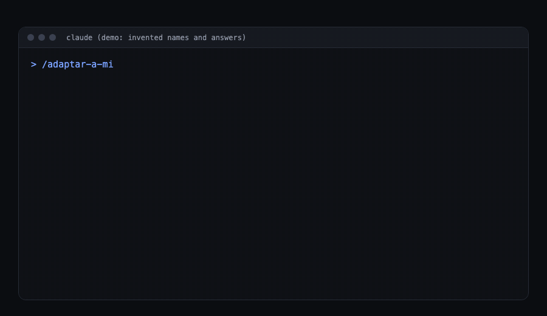

# setup-ceo

English | [Español](README.es.md)

**The Claude Code setup that interviews you and learns how you work.**

Prompts and commands are written in Spanish; Claude answers in your language.



## Install

In the Terminal, in order:

```
claude plugin marketplace add https://github.com/josephalbertoeshkenazi-blip/setup-ceo
claude plugin install ceo-base@setup-ceo
claude plugin install negocios@setup-ceo
claude plugin install diseno@setup-ceo
claude plugin install adaptar@setup-ceo
claude plugin install actualizaciones@setup-ceo
claude plugin install sugerencias@setup-ceo
claude plugin install complementos@setup-ceo
```

Optional, macOS 14 or newer, recommended (see "How Avisos looks" below):

```
claude plugin install avisos@setup-ceo
```

Then, inside Claude Code: `/reload-plugins` (or restart), then `/adaptar:adaptar-a-mi` (the interview: at most 4 simple questions, loses nothing from before). If you installed Avisos, continue with `/avisos:instalar`. For the third-party skills, type `/complementos:instalar-complementos` yourself.

**Shortcut.** Instead of typing the commands, paste this to Claude Code:

```
Install https://github.com/josephalbertoeshkenazi-blip/setup-ceo by following its README.
```

Tested with Claude Code 2.1.304 on macOS, 2026-10-20. It needs macOS: the update check and Avisos use `plutil` and macOS apps.

## Why

Most setups are one list of prompts for everybody. This one interviews you first: `/adaptar:adaptar-a-mi` asks at most 4 simple questions and writes your profile to `~/.claude/mi-perfil/`, outside anything that gets installed, so updates never overwrite it.

Then it learns your taste and how you do business. Each advisor keeps its own memory (`~/.claude/agent-memory/`):

- The design advisor logs whether you liked what it made at first sight and keeps a running counter at the top of its memory: **"approved first try: X of Y"** (in the files it reads "aprobado a la primera: X de Y").
- The design critic, a separate fresh-eyes agent that judges a finished build in a real browser and never edits it, keeps **"agreed with the user X of Y"**. If that stays under 70% after 5 deliveries, it says so in every report, and the playbook tells you to adjust or drop it.
- The business advisor records every deal, what was agreed, how the other side behaved, and what you really earned per hour.

The counters go up with use. If they do not, the setup tells you to switch the team off.

One hard rule: nothing important reaches another person until you say "send it" (`envíalo`).

## What is in it

| Piece | What it does |
|---|---|
| `ceo-base` | Your Claude writes "what I understood" before big tasks, delegates long work, keeps what you correct, and follows a recipe book (which chain of skills for which task; skips skills you do not have). Shabbat rule is optional. |
| `negocios` | A business advisor for prices, deals, partners and contracts, with real numbers. |
| `diseno` | Three design helpers: one directs, one builds, one reviews, so pages and apps look premium. |
| `adaptar` | `/adaptar:adaptar-a-mi`: the interview that writes your profile. |
| `actualizaciones` | `/actualizaciones:novedades`: tells you in plain words what changed; installs only if you say yes. |
| `sugerencias` | `/sugerencias:sugerir-mejora`: sends an improvement idea as a public issue, only after you confirm the text. |
| `complementos` | `/complementos:instalar-complementos`: shows the third-party skills worth having, with why. You choose all, some or none; each repo is checked first; nothing installs without your yes. |
| `avisos` (optional, macOS only) | Calendar cards and a ring per Claude session with a "done" notice. |

## Optional skills, and why

These are other people's projects, installed from their own source at a pinned version. Nothing is copied here. See `plugins/complementos/skills/instalar-complementos/catalogo.md` for exact commands, licenses and commits.

| Skill | Why you would want it |
|---|---|
| superpowers | Claude agrees on what to build before coding, plans in small steps, tests first. |
| gstack | An engineering team as commands: office hours, plan, review, QA in a real browser, ship. Heavy install. |
| graphify | Turns a project into a map you can query instead of re-reading files. |
| impeccable | Fixes UI that looks generic: hierarchy, spacing, type, motion. |
| last30days | What people are saying about a topic in the last 30 days. |
| avoid-ai-writing | Removes AI-sounding phrasing before you send text. |
| hyperframes | Real explainer and promo videos built from scratch. |
| claude-video-vision | Lets Claude watch a video through frames and a transcript. |
| repo-eval | GREEN/YELLOW/RED check of a repo before you install it (ships inside `complementos`). |

## How Avisos looks


An illustration with invented names, not a capture of a real computer. The characters are from the app, made with AI.

## For your Claude

If your human gave you this link: run the commands in "Install" in order. Ask whether they want Avisos and show them the "How Avisos looks" image before you install it. Then tell them to type `/reload-plugins` and run `/adaptar:adaptar-a-mi`. Before you finish, offer the third-party skills ("Want me to show you the important skills, with what each is for?"); if yes, tell them to type `/complementos:instalar-complementos` themselves (only the person who types it can start it); if no, do not insist. Do not install anything else without your human's yes.

## Commands

| Type | What for |
|---|---|
| `/adaptar:adaptar-a-mi` | Write or update your profile |
| `/actualizaciones:novedades` | See what is new and decide whether to install it |
| `/sugerencias:sugerir-mejora` | Send an improvement idea |
| `/ceo-base:nueva-cabeza` | Create a new helper for one of your areas |
| `/complementos:instalar-complementos` | See the important skills and pick which to install |
| `/avisos:instalar` / `/avisos:desinstalar` | Install or remove Avisos |

## Safety

Read `SECURITY.md`: a table of what every piece reads, writes, sends over the network and runs, and how to report a problem.

## Support

Open an issue and it will be read. There is no guarantee of a fast reply. Suggestions are public issues, so put no personal data in them.

## License

Code: MIT (`LICENSE`). Avisos art (characters, icons, images, the app package): its own license, `ART-LICENSE.md`; free to use inside this setup. Third-party skills keep their own licenses; see `NOTICE.md`.
