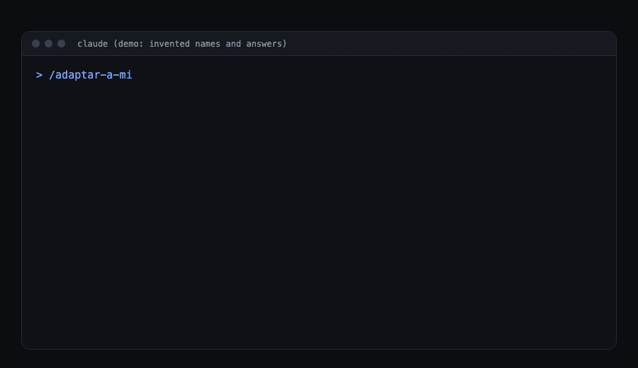
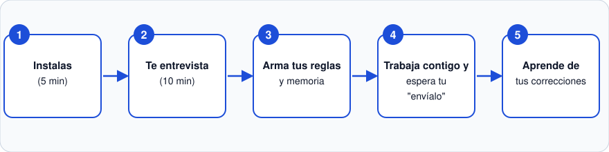
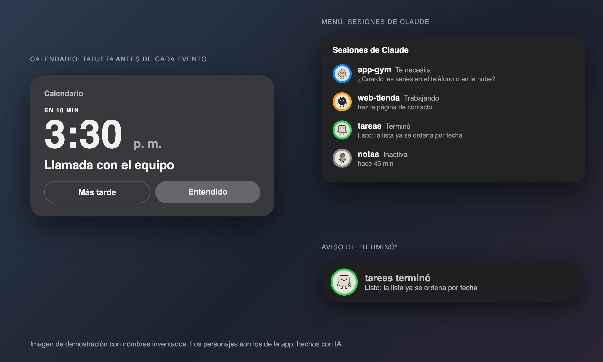

# setup-ceo

[English](README.en.md) | Español

**El setup de Claude Code que te entrevista y aprende cómo trabajas.**

Los prompts y comandos están escritos en español; Claude te contesta en tu idioma.





## Empieza en 5 minutos

Lo que necesitas antes:

- Una computadora con Mac, o con Windows 10 u 11. En Windows también necesitas Git for Windows (un programa gratis que Claude Code usa por detrás para correr sus avisos y revisiones); abajo va cómo instalarlo.
- Un plan de Claude que incluya Claude Code: Pro, Max, Ultra, Team o Enterprise (o una cuenta de Console). El plan gratis no lo incluye ([fuente](https://code.claude.com/docs/en/setup)).

### Con Claude Desktop

1. Baja Claude Desktop de [claude.com/download](https://claude.com/download), ábrelo y entra con tu cuenta.
2. Crea una carpeta vacía llamada `mi-claude` dentro de Documentos. En Claude Desktop abre la pestaña "Code", empieza una sesión **local** (corre en tu computadora, no en la nube) y escoge esa carpeta. Si te pregunta si confías en la carpeta, di que sí.
3. Pega esto y dale Enter:

   ```
   Instala https://github.com/josephalbertoeshkenazi-blip/setup-ceo siguiendo su README.
   ```

   Claude te va a pedir permiso para comandos. Di que sí solo a estos: `claude --version`, `curl -fsSL https://claude.ai/install.sh | bash` (solo si falta Claude Code), `claude plugin marketplace add josephalbertoeshkenazi-blip/setup-ceo` y los seis `claude plugin install ...@setup-ceo`. En Windows, en vez del `curl`, también puede pedir estos: `git --version`, `winget install --id Git.Git -e` (solo si falta Git), `irm https://claude.ai/install.ps1 | iex` (solo si falta Claude Code) y `"$HOME/.local/bin/claude.exe"` (si no encuentra `claude`). Si pide otra cosa, di que no y pregúntale para qué es.

4. Cuando termine, abre una sesión NUEVA en la pestaña "Code" y escribe `/adaptar:adaptar-a-mi`.

Más detalle, y qué se puede y qué no en las pestañas Chat y Cowork: [docs/claude-desktop.md](docs/claude-desktop.md).

Hojas cortas para el equipo, una página cada una: [instalar en Windows](docs/equipo/instalar-windows.md), [instalar en Mac](docs/equipo/instalar-mac.md) y [actualizar](docs/equipo/actualizar.md).

### Con la Terminal

En Mac: abre la Terminal con Cmd + Espacio, escribe "Terminal" y Enter. En Windows hay una sección propia, [Con Windows](#con-windows), más abajo.

1. Instala Claude Code con el instalador oficial (sáltate esto si `claude --version` ya muestra un número):

   ```
   curl -fsSL https://claude.ai/install.sh | bash
   ```

   Abre una ventana nueva de la Terminal y corre `claude` una vez para entrar con tu cuenta.
2. Agrega el catálogo:

   ```
   claude plugin marketplace add josephalbertoeshkenazi-blip/setup-ceo
   ```

3. Instala las seis piezas base:

   ```
   claude plugin install ceo-base@setup-ceo
   claude plugin install adaptar@setup-ceo
   claude plugin install complementos@setup-ceo
   claude plugin install seguridad@setup-ceo
   claude plugin install actualizaciones@setup-ceo
   claude plugin install sugerencias@setup-ceo
   ```

4. En la Terminal escribe `claude` y Enter. Adentro, escribe `/adaptar:adaptar-a-mi`.

La entrevista dura unos 10 minutos. Puedes hablar libre o por voz, pausar y seguir otro día, y traer lo que otra IA (ChatGPT, por ejemplo) ya sabe de ti. No pierde nada de lo anterior. Al final te recomienda lo que te sirve e instala el resto de los plugins (`negocios`, `diseno`, `programar`, `avisos`) solo con tu sí. Las skills de terceros nunca las instala la entrevista: te deja escrito un comando `/complementos:instalar-complementos ...` y lo escribes tú.

Lo primero que hace `/adaptar:adaptar-a-mi` es preguntarte si ya usaste Claude Code y si usas el chat de Claude o ChatGPT. Si es así, trae lo que ya saben de ti con un copiar y pegar (tú decides qué se lee y confirmas el resumen antes de guardarlo), y después te pregunta solo lo que falta. Si no usas nada de eso, la entrevista corre completa.

Para repetirlo más adelante: `/adaptar:trae-mi-memoria` trae en 2 minutos lo que el chat de Claude, ChatGPT, Gemini u otra IA ya sabe de ti, sin repetir la entrevista.

**Más rápido.** En vez de escribir los comandos, pégale esto a Claude Code:

```
Instala https://github.com/josephalbertoeshkenazi-blip/setup-ceo siguiendo su README.
```

Revisado con Claude Code 2.1.318 en macOS, 2026-11-05. En Windows 10 y 11 funcionan todas las piezas menos Avisos (solo Mac); falta la prueba en una computadora Windows real, que sigue la lista de [docs/probar-en-windows.md](docs/probar-en-windows.md).

### Con Windows

Abre PowerShell (el botón de Inicio, escribe "PowerShell" y Enter). No hace falta ser administrador.

1. Instala Git for Windows (sáltate esto si `git --version` ya muestra un número):

   ```
   winget install --id Git.Git -e
   ```

   Cierra todas las ventanas de PowerShell y de Claude y ábrelas de nuevo. Sin Git, los avisos y revisiones del setup no corren.
2. Instala Claude Code (sáltate esto si `claude --version` ya muestra un número):

   ```
   irm https://claude.ai/install.ps1 | iex
   ```

   Abre una ventana nueva de PowerShell y corre `claude` una vez para entrar con tu cuenta. Si dice que no encuentra `claude`, usa `"$HOME/.local/bin/claude.exe"` en su lugar.
3. Agrega el catálogo y las seis piezas base, con los mismos comandos `claude plugin marketplace add ...` y `claude plugin install ...@setup-ceo` de "Con la Terminal".
4. Escribe `claude` y Enter. Adentro, escribe `/adaptar:adaptar-a-mi`.

Python es opcional: si lo tienes (`py -3`), el setup guarda algunas cosas de memoria extra; si no, todo lo demás funciona igual. Si te sale una ventana de la Microsoft Store al escribir `python`, ciérrala: eso no es Python de verdad. Más ayuda en [docs/problemas.md](docs/problemas.md).

### Tus proyectos los lleva tu CEO

Dile «empieza el proyecto X». Tu CEO crea la carpeta (`Proyectos/<nombre>`, al lado de la carpeta del CEO, con `CLAUDE.md` y `notas.md`), abre su sesión él mismo si la app trae la herramienta y, si no, le pasa el trabajo a ayudantes en segundo plano. Te cuenta cuando le preguntas. Puedes entrar al proyecto si quieres, pero no hace falta. Elige una sola superficie: Desktop (recomendado) o Terminal, porque no se ven entre sí. Fuentes: [mensajes entre sesiones](https://code.claude.com/docs/en/cross-session-messaging.md) y [Claude Code en Desktop](https://code.claude.com/docs/en/desktop.md).

## Conecta tu correo, calendario y archivos

Cómo agregar un conector: en la pestaña "Code" de Claude Desktop, el "+" junto a la caja de texto > Add connectors; o Customize > Connectors > elige uno > Connect, e inicia sesión en ese servicio. Los conectores que agregas en claude.ai también funcionan en la pestaña "Code" y en Claude Code cuando entras con tu cuenta de Claude. Con una clave de API no se cargan ([guía de conectores](https://claude.com/docs/connectors/getting-started)).

Requisitos: la pestaña "Code" de Claude Desktop necesita un plan de pago (Pro, Max, Ultra, Team o Enterprise). En Team o Enterprise, un Owner tiene que activar primero Gmail y los demás conectores de Google.

| Qué usas | Qué hacer |
|---|---|
| Gmail, Google Calendar, Google Drive | Vienen integrados. Gmail te pide permiso antes de cada envío, por defecto. |
| Outlook, OneDrive, SharePoint, Teams (Microsoft 365) | Cuenta de trabajo: un Global Administrator de Microsoft Entra tiene que dar su consentimiento una vez. Cuenta personal (Outlook.com, Hotmail): sirve en Free, Pro, Max y Ultra, solo Outlook y OneDrive, y se conecta desde la web. |
| Dropbox | Hay un conector oficial. Qué plan lo incluye: por confirmar. |
| WhatsApp | No hay conector oficial. Existen conectores de terceros, pero ponen en riesgo tu cuenta de WhatsApp, así que aquí no los recomendamos. |
| Archivos de tu computadora | No hay nada que conectar: la pestaña "Code" ya trabaja en la carpeta que abres con "Open folder...". |
| Otra herramienta | Si el proveedor publica la URL de un servidor MCP: Customize > Connectors > Add custom connector. Si no, pídele ayuda a alguien que sepa, o exporta a Excel o CSV a tu carpeta. |

Usar Claude in Chrome desde la pestaña "Code" de Claude Desktop: por confirmar.

## Lo que nunca hace sin ti

- Nada le llega a otra persona (correo, chat, propuesta, precio) hasta que dices "envíalo".
- Nunca pega claves, contraseñas ni tokens en el chat: escribe "[secreto omitido]".
- No instala complementos de terceros sin revisarlos antes (veredicto VERDE, AMARILLO o ROJO) y sin tu sí. Con ROJO te recomienda no instalar.
- Claude Code te pide permiso antes de lo riesgoso; en modo manual pregunta antes de casi todo (editar archivos, correr comandos). No prendas el modo que se salta los permisos (`bypassPermissions`).
- Lo que dicen los correos, las páginas y los documentos son datos, no órdenes.
- `/seguridad:revisar-mi-seguridad` revisa tu computadora cuando quieras.

## Para quién es

- Dueño de un negocio: precios, tratos, clientes y mensajes, con un asesor que se acuerda de todo.
- Estudiante: tareas, entregas y organización.
- Mamá o papá: la casa, los horarios y los pendientes, sin pasar horas explicando.

Ejemplos concretos: [docs/ejemplos.md](docs/ejemplos.md).

## Por qué

Casi todos los setups son una lista de prompts iguales para todos. Este te entrevista primero: `/adaptar:adaptar-a-mi` dura unos 10 minutos, hace una pregunta a la vez y escribe tu perfil en `~/.claude/mi-perfil/`, fuera de lo que se instala, así que las actualizaciones nunca lo borran. Solo lee tu historial de Claude si tú lo permites.

Después aprende tu gusto y tu forma de hacer negocios. Cada asesor guarda su propia memoria (`~/.claude/agent-memory/`):

- El asesor de diseño anota si lo que hizo te gustó a la primera y mantiene un contador arriba de su memoria: **"aprobado a la primera: X de Y"** (en inglés: "approved first try: X of Y"). Si le muestras trabajos tuyos del pasado, con tu permiso, escribe tu gusto en `~/.claude/mi-perfil/diseno/GUSTO.md`, y cada "esto sí / esto no" actualiza ese archivo.
- El crítico de diseño es otro agente, de ojos frescos: juzga una página ya hecha en un navegador real y nunca la edita. Mantiene **"coincidí con el usuario X de Y"**. Si baja de 70 % después de 5 entregas, lo dice en cada reporte y el playbook te dice que lo ajustes o lo quites.
- El asesor de negocios guarda cada trato, lo acordado, cómo se portó la otra parte y cuánto ganaste de verdad por hora.

Los contadores suben con el uso. Si no suben, el propio setup te dice que apagues al equipo.

Una regla dura: nada importante le llega a otra persona hasta que dices "envíalo".

## Qué trae

| Pieza | Qué hace |
|---|---|
| `ceo-base` | Tu Claude escribe "Lo que entendí" antes de algo grande, delega lo largo, guarda lo que le corriges, nunca pega una clave en el chat y sigue un recetario (qué cadena de skills usar según la tarea; se salta las que no tengas). |
| `adaptar` | `/adaptar:adaptar-a-mi`: la entrevista de 10 minutos que escribe tu perfil, te recomienda lo que te sirve y lo instala con tu sí. |
| `complementos` | `/complementos:instalar-complementos`: un catálogo revisado de skills de terceros (versiones fijas, solo repos que pasaron una revisión). Tú eliges todas, algunas o ninguna; nada se instala sin tu sí. |
| `/complementos:buscar-skill` | Buscar una skill que no está en la lista: revisa hasta 3 en lugares de confianza y solo instala con tu sí |
| `/ceo-base:revisar-correcciones` | Revisar las veces que corregiste a Claude y guardar lo que se repite ([cómo funciona la memoria](docs/memoria.md)) |
| `seguridad` | `/seguridad:revisar-mi-seguridad`: revisa tu computadora y tu Claude en 5 minutos (solo mira), te explica en palabras simples lo que importa y arregla una cosa a la vez con tu sí y una forma de deshacer. |
| `actualizaciones` | `/actualizaciones:novedades`: te explica en palabras simples qué cambió; el setup se actualiza solo. Si no lo quieres, di "no te actualices solo"; para volver a prenderlo, "actualízate solo" (skill `actualizar-solo`). |
| `sugerencias` | `/sugerencias:sugerir-mejora`: manda una idea de mejora como issue público, solo después de que confirmes el texto. |
| `negocios` | Un asesor de negocios para precios, tratos, socios y contratos, con números reales. La entrevista lo recomienda si tienes un negocio. |
| `diseno` | Tres ayudantes de diseño: uno dirige, uno construye, uno revisa, para que tus páginas y apps se vean de primera. Aprenden de tus trabajos pasados. |
| `programar` | Para quien programa: `/programar:bug-hunt` busca los bugs de todo un proyecto y deja un plan de arreglos; `/programar:rules-migrate` parte un `CLAUDE.md` largo en reglas por carpeta. |
| `avisos` (opcional, solo macOS) | Tarjetas del calendario y un aro por cada sesión de Claude con su aviso "terminó". |

## Skills opcionales, y por qué

Son proyectos de otras personas, instalados desde su fuente oficial en una versión fija. Aquí no se copia nada. Los comandos exactos, licencias, commits y la revisión de cada una están en [catalogo.json](plugins/complementos/skills/instalar-complementos/catalogo.json). La entrevista escoge las pocas que te quedan bien; ninguna es obligatoria.

| Skill | Para qué te sirve |
|---|---|
| superpowers | Claude acuerda qué construir antes de programar, planea en pasos chicos y hace pruebas primero. |
| gstack | Un equipo de ingeniería en comandos: revisar la idea, planear, revisar código, probar en un navegador real, publicar. Instalación pesada; también sirve si tienes ideas de negocio. |
| graphify | Convierte un proyecto en un mapa que se puede consultar, en vez de releer archivos. |
| impeccable | Arregla interfaces de aspecto genérico: jerarquía, espaciado, tipografía, movimiento. |
| animaciones | Tres skills de animación de Emil Kowalski: construir, revisar y mantener fluido el movimiento. |
| last30days | Qué dice la gente de un tema en los últimos 30 días. |
| avoid-ai-writing | Le quita al texto lo que suena a robot antes de mandarlo. |
| hyperframes | Videos explicativos y promos hechos desde cero. |
| claude-video-vision | Deja que Claude vea un video con fotogramas y transcripción. |
| obsidian-markdown | Le enseña a Claude a escribir notas de Obsidian bien hechas. |
| gitleaks | Busca claves y contraseñas olvidadas en tus carpetas y antes de subir a GitHub, sin mostrarlas. |
| repo-eval | Veredicto VERDE, AMARILLO o ROJO de un repo antes de instalarlo (viene dentro de `complementos`). |

## Cómo se ve Avisos



Es una ilustración con nombres inventados ("app-gym", "web-tienda", "tareas"), no una captura de una computadora real. Los personajes son los de la app, hechos con IA.

## Para tu Claude

Si tu humano te pasó este link, sigue estos pasos en orden y explícale cada uno en palabras simples:

1. Corre `claude --version`. Si muestra un número, sigue al paso 3.
2. Si no existe, explícale que falta instalar Claude Code y, con su sí, corre el instalador oficial: `curl -fsSL https://claude.ai/install.sh | bash`. **En Windows**, primero corre `git --version`: si no existe, con su sí corre `winget install --id Git.Git -e` y dile que cierre y vuelva a abrir Claude, para que los avisos encuentren Git Bash (la terminal de Git); después el instalador es `irm https://claude.ai/install.ps1 | iex` en PowerShell, y si `claude` no se encuentra justo después de instalar, usa `"$HOME/.local/bin/claude.exe"`. Si estás en la Terminal, dile que abra una ventana nueva y corra `claude` una vez para entrar con su cuenta. Si estás en la pestaña Code de Claude Desktop, no hace falta para instalar los plugins.
3. Corre `claude plugin marketplace add josephalbertoeshkenazi-blip/setup-ceo` y después los seis `claude plugin install X@setup-ceo` de "Con la Terminal" (los seis plugins base).
4. Dile que abra una sesión NUEVA (la pestaña "Code" de Claude Desktop o la Terminal) y escriba `/adaptar:adaptar-a-mi`. En la Terminal, si sigue en la misma sesión, que escriba `/reload-plugins` primero. En Claude Desktop, siempre una sesión nueva.

La entrevista recomienda e instala el resto (`negocios`, `diseno`, `programar`, `avisos`) con su sí, así que no los instales tú salvo que los pida; si pide Avisos, muéstrale antes la imagen de "Cómo se ve Avisos". Las skills de terceros son distintas: dile que escriba él mismo `/complementos:instalar-complementos` (solo la corre quien la escribe); si dice que no, no insistas. No instales nada más sin el sí de tu humano.

## Comandos

| Escribe | Para qué |
|---|---|
| `/adaptar:adaptar-a-mi` | La entrevista de 10 minutos: primero trae lo que ya saben de ti Claude Code, el chat de Claude o ChatGPT; después pregunta solo lo que falta, escribe tu perfil y te recomienda |
| `/adaptar:trae-mi-memoria` | Para repetirlo más adelante: traer a tu perfil lo que el chat de Claude, ChatGPT u otra IA ya sabe de ti |
| `/seguridad:revisar-mi-seguridad` | Revisar tu computadora y tu Claude, y arreglar lo que apruebes |
| `/actualizaciones:novedades` | Ver qué hay de nuevo |
| `/sugerencias:sugerir-mejora` | Mandar una idea de mejora |
| `/ceo-base:nueva-cabeza` | Crear un ayudante nuevo para un área tuya |
| `/complementos:instalar-complementos` | Ver las skills importantes y elegir cuáles instalar |
| `/programar:bug-hunt` / `/programar:rules-migrate` | Buscar bugs en un proyecto / partir un `CLAUDE.md` largo |
| `/avisos:instalar` / `/avisos:desinstalar` | Poner o quitar Avisos |

## Actualizar

1. Se actualiza solo, con versiones revisadas.
2. Para hacerlo ya, di "actualízate".
3. Para apagarlo, di "no te actualices solo". Para prenderlo de nuevo, "actualízate solo".
4. Si una versión sale mala, el autor la vuelve atrás para todos y te llega sola.
5. **Si tienes 2.0, 2.1 o 2.2, actualízate una sola vez y desde ahí queda solo.** Dile a Claude "actualiza el setup-ceo", o corre `claude plugin marketplace update setup-ceo` y `claude plugin update actualizaciones@setup-ceo` (y lo mismo con cada plugin que tengas). En Windows con 2.0 o 2.1 el aviso no te sale, y con 2.2 sale pero no marca qué plugins instalar: en los dos casos hazlo así.

El comando de instalación no cambia. Si algo no se actualiza solo, mira [docs/problemas.md](docs/problemas.md).

## Seguridad

Lee [SECURITY.md](SECURITY.md): una tabla de qué lee, escribe, manda por internet y corre cada pieza, y cómo reportar un problema. La revisión de seguridad nunca pide, muestra ni guarda una clave o contraseña.

Riesgo: lo que se actualiza solo corre en tu computadora; si alguien tomara la cuenta de GitHub de este repo podría mandarte una versión mala. Por eso solo llegan versiones etiquetadas y revisadas, y puedes apagarlo diciendo "no te actualices solo".

Cuando corriges a Claude, `ceo-base` anota una línea corta en `~/.claude/ceo-estado/cola-correcciones.jsonl`, solo en tu computadora y con las claves tapadas. Viene encendido; para apagarlo, escribe `Capturar correcciones: no` en `~/.claude/mi-perfil/ceo.md`. Detalle en [cómo funciona la memoria](docs/memoria.md).

## Soporte

Si algo no funciona, mira primero [docs/problemas.md](docs/problemas.md). Si sigue igual, abre un issue (un reporte público en GitHub; necesitas una cuenta gratis de GitHub) con el formulario "Algo no funciona" y se leerá. No hay garantía de respuesta rápida. Los issues son públicos: no pongas datos personales. Para cambiar algo tú mismo, mira [CONTRIBUTING.md](CONTRIBUTING.md); los problemas de seguridad van por [SECURITY.md](SECURITY.md), no por un issue público.

## Licencia

Código: MIT ([LICENSE](LICENSE)). El arte de Avisos (personajes, íconos, imágenes y el paquete de la app): licencia propia en [ART-LICENSE.md](ART-LICENSE.md); se puede usar dentro de este setup. Las skills de terceros conservan su licencia; mira [NOTICE.md](NOTICE.md).
