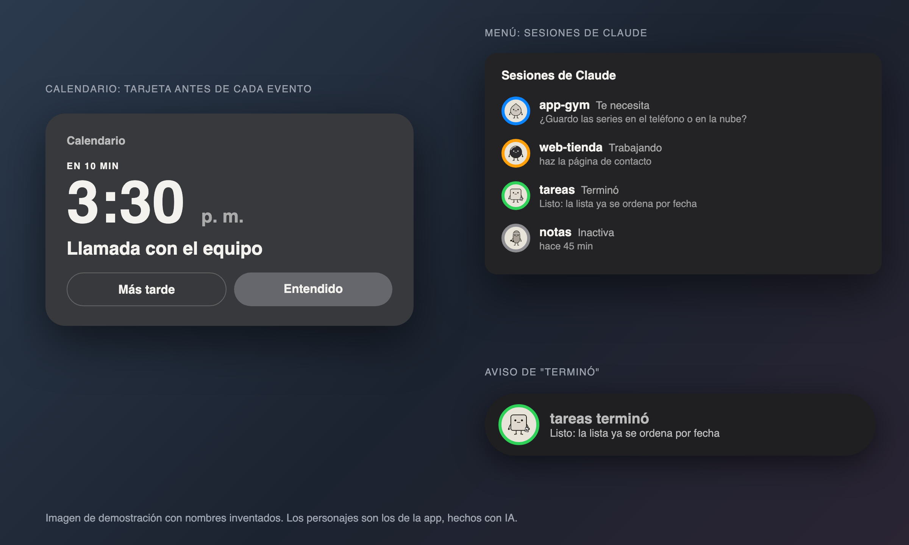

# Avisos

Una app de la barra de menú de la Mac:

- **Calendario:** una tarjeta grande en el centro de la pantalla 10 minutos antes de cada evento y otra vez a la hora exacta.
- **Sesiones de Claude Code:** cada sesión abierta en la Terminal aparece como un personaje dentro de un aro. Gira mientras Claude trabaja, se pone azul cuando Claude te necesita y verde cuando termina.
- **"Terminó":** cuando una sesión acaba, sale un aviso chico arriba en la pantalla. Un clic y estás en esa pestaña.
- **Shabbat y Yom Tov:** si lo prendes en Ajustes, no muestra nada en ese tiempo y te enseña lo pendiente al salir.

Es gratis, no manda nada a internet y no necesita cuenta. Necesita macOS 14 o más nuevo.

## Cómo se ve



Es una demostración con nombres inventados, no una captura de una computadora real.

## Instalar

Si todavía no tienes el plugin, en la Terminal:

```
claude plugin install avisos@setup-ceo
```

Después, dentro de Claude Code, escribe:

```
/avisos:instalar
```

Claude hace casi todo. Tú solo haces tres clics cuando te lo pida: abrir la app la primera vez (si macOS lo pregunta), **Permitir** el calendario y **Aceptar** que Avisos controle Terminal.

## Quitar

```
/avisos:desinstalar
```

Quita los ganchos de Claude Code sin tocar nada más, y te pregunta si quieres borrar también la app y tus datos.

## Licencia

Las skills y los ganchos de este plugin son código: MIT. Solo el arte dentro del zip de la app (personajes, íconos, imágenes) tiene otra licencia: ver `ART-LICENSE.md` en la raíz del repositorio.
